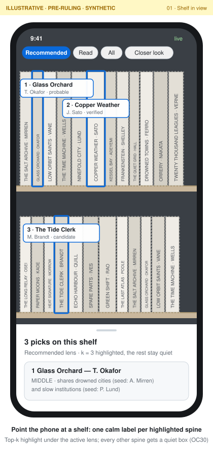
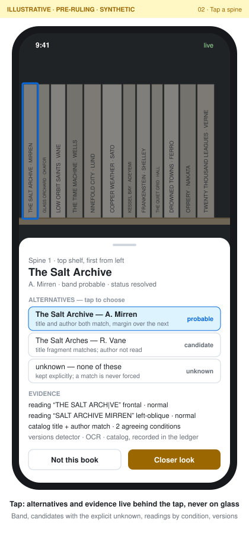
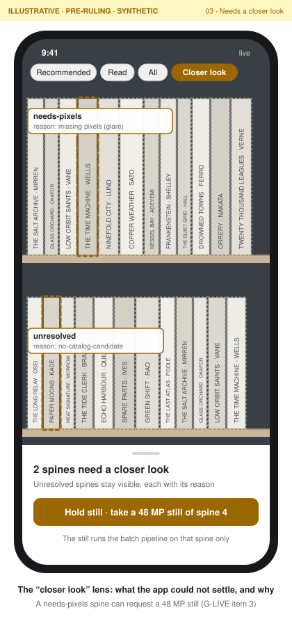
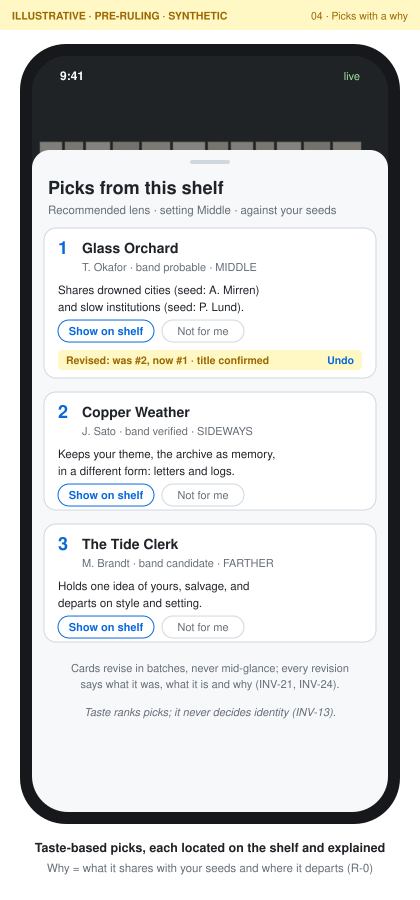

# BookcaseDiscovery

Point a phone at a bookstore bookcase and learn which spines are worth pulling. BookcaseDiscovery identifies books from partial evidence and never forces a match. It explains every pick against your own tastes and shows where the book sits on the shelf. It is built in public as a measured, teachable example of a pipeline plus one bounded LLM step ([northstar](.claude/northstar.md)).

<p>
  <a href="docs/wireframes/01-live-view.svg"></a>
  <a href="docs/wireframes/02-spine-detail.svg"></a>
  <a href="docs/wireframes/03-closer-look.svg"></a>
  <a href="docs/wireframes/04-recommendations.svg"></a>
</p>

*Demo wireframes: illustrative, pre-ruling, synthetic content. [What each screen shows](docs/wireframes/README.md), including [the batch report](docs/wireframes/05-batch-report.svg).*

## Where it stands

The MVP is being built card by card from the [delivery plan](docs/plan/DELIVERY-PLAN.md). The foundations are in: contracts, the event ledger, ingest, the catalog, the reading profile, the OCR helper and the report scaffold. Spine detection, identification and ranking come next. Progress is tracked in the [roadmap](.claude/roadmap.md) and the repo's merged pull requests.

The `bookcase` CLI. `bin/bookcase --help` lists every command; commands whose card has not landed print a stub message.

| Command | What it does | Docs |
|---|---|---|
| `bookcase ingest <folder> --session <name>` | Verifies exported originals and appends them to the ledger and the image store | [ingest](docs/ingest.md) |
| `bookcase manifest <session>` | Writes the public fixture manifest: hashes, dimensions, setting; no capture time, GPS or images | [ingest](docs/ingest.md) |
| `bookcase replay <db> --to <fresh db>` | Rebuilds every view from the events and diffs them | [ledger](docs/ledger.md) |
| `bookcase catalog build \| query \| eval` | Builds the local ISFDB catalog and retrieves candidates for spine fragments | [catalog](docs/catalog.md) |
| `bookcase profile check \| build \| review` | Validates the public seeds and builds the private reading profile | [profile](docs/profile.md) |
| `bookcase report <session>` | Writes the local HTML report: spines boxed by status and band | [report](docs/report.md) |

## How it works

```
capture ──► perceive ──► identify ──► recommend ──► report
(ingest)    detect +     catalog       rank against   boxes, bands,
            OCR, cheap   candidates,   the profile,   picks, the
            pass         bands, one    with a why     unresolved queue
                         bounded LLM
                         step
       └──────────── every step appends events to one ledger ────────────┘
```

- **Ledger.** Every step appends typed events to an append-only SQLite log. Views (observations, bands, statuses, recommendations) are derived from it, and `replay` rebuilds them identically (INV-14).
- **Contracts.** The JSON Schemas in [`contracts/`](contracts) are the source of truth for events and for the Swift and Python helpers (OC13). See [`docs/contracts.md`](docs/contracts.md).
- **Bands, not probabilities.** An identity is `verified`, `probable`, `candidate` or `unknown`. A spine that cannot be settled stays `unresolved`, with a reason. The reader's taste ranks recommendations and never touches identity (INV-13).

Terms are defined in [`CONTEXT.md`](CONTEXT.md).

## Develop

Node ≥22.18 runs the TypeScript directly, so there is no build step. Use pnpm.

```sh
pnpm install
pnpm test          # vitest
pnpm typecheck     # tsc --noEmit
pnpm guard         # privacy guard over the git index (also the pre-commit hook)
bin/bookcase --help
```

The macOS OCR helper lives in [`helpers/ocr-vision`](helpers/ocr-vision). Data (photos, the ledger, the catalog, reports) goes under `$BOOKCASE_DATA`, which defaults to `~/data/bookcase-discovery/`, never into the repo.

## Plan

- [`docs/plan/`](docs/plan/README.md) is canonical: [delivery plan](docs/plan/DELIVERY-PLAN.md) (cards, gates, critical path), [requirements](docs/plan/REQUIREMENTS.md) (OC and INV numbers), [operating model](docs/plan/OPERATING-MODEL.md) and the [architecture draft](docs/plan/ADR-DRAFT-bookcase-discovery-architecture.md).
- Gate rulings are in [`docs/gates/`](docs/gates). Deviations from the plan are logged in [`implementation-notes.md`](implementation-notes.md).
- Fleet registration: [`.claude/northstar.md`](.claude/northstar.md) and [`.claude/roadmap.md`](.claude/roadmap.md) are registered in ojfbot/core's northstar registry as `l1-bookcase-discovery`.

## Privacy

The repo is public. Photos, crops, labels, per-spine results and any personal data stay on the owner's machine under `$BOOKCASE_DATA` and never enter git (OC9). [`docs/privacy.md`](docs/privacy.md) says where each kind of data lives and how to purge it. `pnpm guard` and `pnpm guard --history` enforce it, locally and in CI.

## Licence

AGPL-3.0. See [`LICENSE`](LICENSE) and [`NOTICE`](NOTICE).
