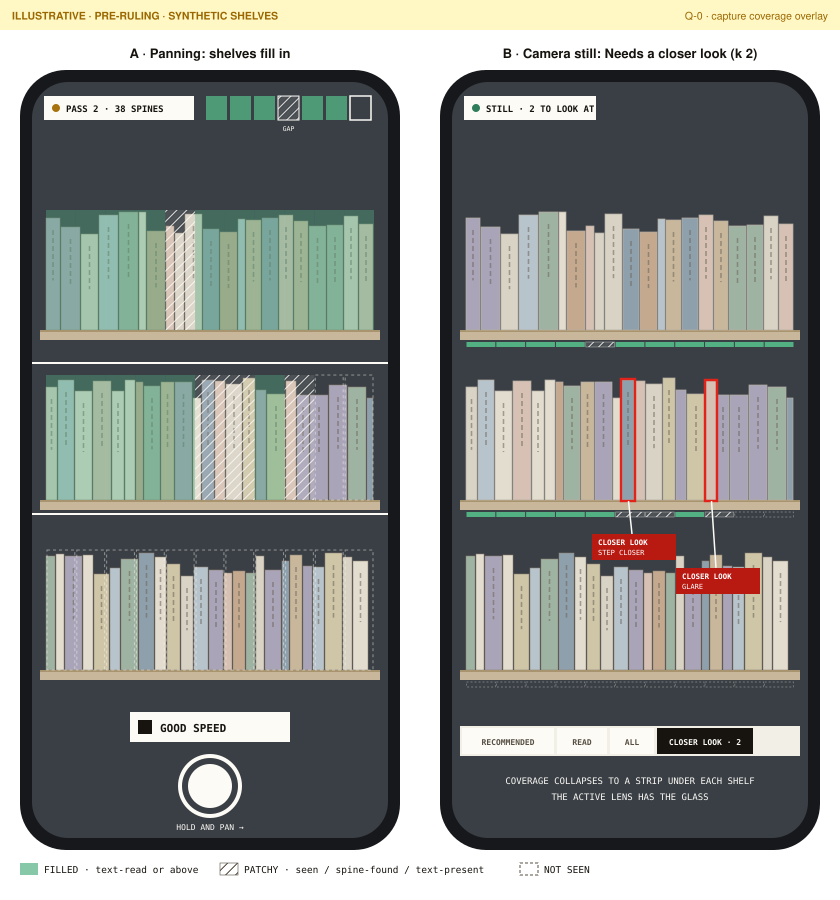
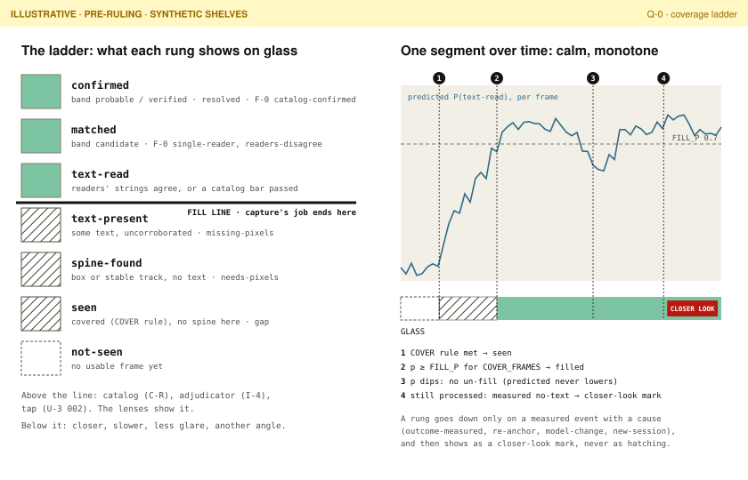

# Capture coverage: the model behind the fill-in overlay (Q-0)

> **Status: design proposal, 2026-11-02 (card Q-0, the first card of the capture-quality track).** Docs only, no app code. Nothing here is ruled. Every threshold, cost and effect size is a **hypothesis** unless it cites a measured source (INV-17). The Q track is not in `DELIVERY-PLAN.md` yet; the conductor amends the plan.
> **Reads:** OC30, OC31, OC34–OC36, INV-20, INV-22, INV-24 in `docs/plan/REQUIREMENTS.md`; U-1 ([`overlay-ux.md`](../plan/docs/live/overlay-ux.md), ruled) and U-2 ([`guided-sweep-ux.md`](../plan/docs/live/guided-sweep-ux.md), delivered, ruling pending); cards K-0, T-2, T-3, T-5, T-7a, T-9; [`capture-protocol.md`](../capture-protocol.md); [`ingest-verification.md`](../ingest-verification.md); [`models/open-weights.md`](../models/open-weights.md) (H-0); F-0's `docs/machine-labelling.md` and `evals/F0/report.md` (PR #23).
> **Wireframes** (illustrative, pre-ruling, synthetic shelves): [`coverage-overlay.svg`](coverage-overlay.svg), [`coverage-ladder.svg`](coverage-ladder.svg).

## In short

- **What gets coloured: a coverage segment.** It is a piece of a shelf band about two median spine widths long. A still anchors it to working-copy pixels, and a live session anchors it to stable tracks (T-2). It is not a whole spine, because the patchy places are often where no spine was found (F-0's gap share on `pilot-000` is 13.9 %). It is not a 2-D grid cell either, because that needs a shelf plane the plan does not build (§2).
- **What "captured well enough" means: rung `text-read`.** Capture's job ends where the text is readable. A spine whose text is read but not in the catalog is **filled**: re-panning cannot fix a catalog gap, so the overlay must not ask for it (§3).
- **Glass shows three states:** blank (`not-seen`), hatched (`seen`, `spine-found`, `text-present`: patchy, capture can still help) and filled (`text-read` or above). Identity stays with U-1's lenses, not with the fill.
- **Two tiers (working assumption, owner question in §9):** a cheap **predicted** fill while panning, from on-device signals, then a **measured** outcome after each still or sweep, from the full pipeline. A measured outcome that turns out worse than the prediction does **not** un-fill the segment. It becomes a candidate for the "Needs a closer look" lens (k 2), so the fill never flickers back (INV-24).
- **Teacher–student:** F-0's pipeline is the slow teacher. The first student target is **P(`text-read` | cheap signals) per spine**, scored by AUC and calibration, with leave-one-image-out folds, and reported for the yardstick (PROXY) and `pilot-000` (real use) separately (§5).
- **Next experiments** (each about one day, no owner time): **Q-2** teacher table and first student · **Q-3** coverage map on stills · **Q-4** pixels and blur thresholds from degraded stills · **Q-5** glare and angle · **Q-6** live slice in T-5/T-7a (§6).

## 1. What the overlay is for

Touch ID enrolment shows a fingerprint that fills in ridge by ridge as each touch is captured. The template is fixed, progress only moves forward, and the user learns where to press next without reading anything. The bookcase version: as the phone pans, each part of each shelf **fills in** once the system has pixels good enough to read it. The part still **patchy** shows where to slow down, step closer or change the angle.

Two differences from Touch ID shape the model:

1. **The template is discovered, not known.** The shelf bands and their extent appear as you pan. "Not seen yet" can only be drawn for what is in frame but not yet captured, and as the open end of U-2's ribbon.
2. **Capture can only fix part of the problem.** On `pilot-000`, 3435 of 6894 detected spines are `unknown` for `no-catalog-match` (F-0). Some of those have garbled text (a capture problem) and some are simply not in ISFDB (a catalog problem, for C-R). If the fill waited for identification, it would ask the shopper to re-pan forever over a catalog gap. So the fill tracks **readability**, and identification stays with the lenses (§3).

Two things are kept apart throughout:

- **Capture coverage** is how well each place on the case has been captured for reading. It is new and proposed here.
- **Recognition coverage** is identified spines over all spines (OC32, an existing term).

A shelf can be fully captured and still hold `unknown`s whose cause is the catalog.

## 2. Unit of coverage

### Options

| Unit | For | Against | Verdict |
|---|---|---|---|
| **Per spine** (a box or track) | It is the unit of every outcome (F-0, I-3, OC32). Matches U-1's per-spine boxes | A patchy place often *has no spine yet*: missed detections and gaps (13.9 % of band length on `pilot-000`, a lower bound). Live, a spine is about 20–40 px wide (§4, S-L1), and its box flickers with tracker ID switches (T-2), so per-spine fill would jitter. There is nothing to colour before the detector runs | **Outcome unit**, not display unit |
| **Grid cell in a shelf-plane frame** | Uniform, and covers empty regions | Needs a registered shelf plane (homography, or an ARKit vertical plane) that no card builds. Cells cut across spines and shelves, and rows between shelves are meaningless. Ultra-wide distortion and angled shots (H-0's real-use stress) make a planar grid wrong at the edges | Not now. It remains an option if T-7a adopts an ARKit plane (*hypothesis*: cost and stability unmeasured) |
| **Shelf-band segment** | One-dimensional along the shelf, which is the pan axis. Matches U-2's ribbon (a strip along the pan), F-0's gap share (band length with no box) and OC32's per-shelf reporting. Covers gaps and spines alike. Coarse enough to be calm, fine enough to point at one to three spines | Needs bands. On stills these are F-0's rows of boxes, and live they come from tracks. Before a detector runs, only frame-level signals apply | **Recommended** |

### The coverage segment

- **Shape:** a piece of one shelf band, about **2 median spine widths** long along the band (about 5 cm on a typical case; *hypothesis*, Q-3 tunes it). Lengths are in median-spine-width units, so the segment is scale-free across stills, live frames, 12 MP and 48 MP.
- **On a still:** bands are F-0's rows of spine boxes, in working-copy pixels. Position along a slanted or curved band is arc length along the polyline through box centres, so angled ultra-wide shots need no homography. Each still is its own map.
- **Live (T-2 and later):** a segment is anchored to the stable tracks whose centres fall in it. A segment in a gap is interpolated between its neighbours' tracks. Panning moves the anchors, not the segment, so the same piece of shelf keeps its state across frames. Track loss or an ID switch does not reset the segment (§7, monotone rule).
- **A segment's rung** is the **minimum** rung over the spines in it whose box score is at or above a floor, so that a false box does not pin it down. A gap of at least ½ a median width (F-0's gap test) counts as `seen` with no spine. A segment is filled only when everything in it is readable, which is the Touch ID honesty: no partial credit inside a unit.
- **A spine's rung across frames** is the **maximum** over its frames (T-3 already keeps the best frames per track). A segment's rung is the minimum of its spines' maxima.

### Across pans and stills

| Situation | What happens | Owner card |
|---|---|---|
| One still | One map in working-copy pixels | Q-3 |
| Several stills of one case | **Separate maps.** No card registers stills to one another. Registering them (feature matching and homography per band) would be new work, not proposed now | Unplanned; logged |
| Live pan, one shelf | Segments ride stable tracks, and the rung rises as new frames arrive | T-2 tracks; Q-6 |
| Guided sweep, several passes | Each pass covers the band between U-2's rails. A RE-SWEEP pass merges into the same sweep (U-2 §4), so its segments can rise. Whether a pass continues the same shelf sideways is U-2 open question 10 | T-9 |
| Live pan across shelves | The band index comes from vertical order within the frame. Matching band indices across a vertical pan is not solved, so each pass is treated as its own band set until T-2 measures it | T-2 |

## 3. Outcome ladder

Seven rungs, ordered, each implying the ones below it. The left columns are the existing vocabulary (`CONTEXT.md`, `docs/contracts.md`, F-0, U-2). Only the rung names are new.

| Rung | Means | Status | Band | Unresolved reason (INV-8) | F-0 | U-2 reason code | Glass |
|---|---|---|---|---|---|---|---|
| `not-seen` | No usable frame or still has covered this place | none | none | none | outside the photo | (not in the sweep) | blank |
| `seen` | Covered: inside a still, or for live, U-2's COVER rule (≥ COVER_FRAMES sharp frames in COVER_ZONE). No spine box here | none (no observation) | none | none (no observation; inferred gap) | gap | `DETECTION_GAP` | hatched |
| `spine-found` | A box (`SpineObserved`) or a stable track. No reader produced text | `unresolved`; `needs-pixels` when a pixel signal is limiting | `unknown` | `missing-pixels` | `no-text` (this also holds false boxes; Q-1 splits them) | `RUSHED`, `DARK_GLARE` | hatched |
| `text-present` | Some reader produced text, but nothing corroborates it: no reader passes the catalog bar, and no two readers' strings agree | `unresolved` / `needs-pixels` | `unknown` | `missing-pixels` | the garbled part of `no-catalog-match` | `RUSHED`, `DARK_GLARE` | hatched |
| **`text-read`** | **Readable:** two readers' strings agree (normalised similarity ≥ τ, *hypothesis*, Q-2 sets τ), or one reader's top candidate passes the catalog bar | `unresolved` | `unknown` | `no-catalog-candidate` (readable, not in catalog) | the agreeing-string part of `no-catalog-match` | `NO_MATCH` | **filled** |
| `matched` | Catalog candidates are alive, with no unique two-reader agreement | `unresolved` | `candidate` | `conflicting-evidence` when readers disagree | `single-reader`, `readers-disagree` | `TWO_MATCHES` | filled |
| `confirmed` | Identity held: two readers and the catalog agree, or there is an owner correction or an ISBN | `resolved` | `probable` or `verified` | none | catalog-confirmed (accepted) | (identified) | filled |

Notes:

- **The fill line is between `text-present` and `text-read`.** Below it, better capture can help: closer, slower, less glare, another angle. Above it, the remaining work belongs to the catalog (C-R), the adjudicator (I-4) or a tap (U-3 002), and the lenses show it.
- **`no-text` and `no-catalog-match` each mix two causes.** `no-text` holds real spines with too few pixels *and* false boxes; on `pilot-000` the box score is low (p50 0.243). `no-catalog-match` holds garbled text *and* readable text missing from the catalog. Q-1 and Q-2 split them. Until then the mapping above is a proposal.
- **Bands are I-3's.** Mapping F-0's `single-reader` to `candidate` and catalog-confirmed to `probable` is Q-0's reading. I-3 owns band rules.
- **`needs-pixels`** keeps its meaning: a spine below `text-read` whose limiting signal is a pixel signal (S-L1 to S-L5) is the candidate for pixels on demand and for the closer-look lens.
- **For scale only** (`pilot-000`, machine agreement, not accuracy): `confirmed` 10.4 % (718); `matched` 14.6 % (923 single-reader plus 80 readers-disagree); `no-catalog-match` 49.8 % (3435), split between `text-present` and `text-read` (unknown until Q-1); `no-text` 25.2 % (1738); plus a gap share of 13.9 % of band length.

## 4. Signals, ranked by cost

Three tiers. A signal predicts the rung named, and each carries a hypothesis for Q-2 to Q-5 to test. Costs marked *measured* come from F-0 (one M-series Mac) or C-3. The rest are *hypothesis*.

### Tier L: live, per frame, on the phone

| Id | Signal | Cost per frame | Predicts | Hypothesis |
|---|---|---|---|---|
| S-L1 | **Pixels per spine.** Median live box width when a detector runs (T-7a); before that, from focus distance or LiDAR depth and the focal length in pixels | ~0 from metadata; free with boxes | `text-read` ceiling | Below about 18–25 px of spine width the `text-read` rate is near zero, and above about 60 px it plateaus (U-2 SPINE_PX starts at 18). Arithmetic: a whole-case frame puts a spine at about 2 % of the width, so about 22 px on a 1080-px-wide portrait frame and about 43 px at 4K. **A whole case in one live frame cannot fill. Stepping closer is what fills it**, the way pressing again fills Touch ID |
| S-L2 | **Sharpness**: variance of the Laplacian on downscaled luma inside the rails, divided by the pass's running p75 (U-2) | < 2 ms on GPU | `text-present` vs `text-read` | Ratio < 0.45 rarely reaches `text-read` (U-2 SHARP_RATIO slow 0.45) |
| S-L3 | **Predicted blur from the IMU**: ω × exposure time × pixels per degree (U-2) | ~0 | same, before the frame arrives | Above about 2 px of blur along the pan, text reads collapse (U-2 BLUR_GOOD 2 px). Spine text runs across the pan, so the smear hits glyph strokes first |
| S-L4 | **Exposure**: exposure duration, ISO, mean luma, clipped share | ~0 (histogram) | `spine-found` vs `text-present` in dim cases | Under-exposed bands lose `text-present` before they lose boxes |
| S-L5 | **Glare and specular highlights**: share of near-saturated pixels in connected blobs inside a band or segment | ~1 ms | local `no-text` | Glare is local: one segment goes patchy while its neighbours fill. Glossy jackets under store lights dominate it (K-0 §5) |
| S-L6 | **Viewing angle and keystone**: convergence of shelf lines, or device attitude against a vertical plane | a few ms at low resolution; ~0 from attitude | `text-read` through foreshortening (×cos θ on spine width); also the INV-20 viewpoint bucket | Beyond about 45° from frontal, `text-read` falls faster than S-L1 alone predicts |
| S-L7 | **Coverage so far**: segments that have met the COVER rule | ~0 (bookkeeping) | `seen` | This is the base layer of the overlay; it needs no model |
| S-L8 | *(optional, live-heavy)* **text presence**: Vision text-rectangle detection, no recognition, at a few Hz | tens of ms on the ANE | `text-present` | It is the cheapest direct readability evidence on device. Whether it fits the frame budget is T-6/T-7a's to measure |

### Tier S: per still, on the Mac or after capture

| Id | Signal | Cost | Predicts | Hypothesis |
|---|---|---|---|---|
| S-S1 | **Detector confidence and box density**: box scores; boxes per median width along a band; gap share | detection *measured*: p50 5.1 s per shelf-scale image (yardstick, B2), 78 s per tiled 48 MP whole-case image (`pilot-000`) | `seen` vs `spine-found`; false boxes | Boxes below the score floor mostly end as `no-text` (Q-1) |
| S-S2 | **Per-crop measures**: crop width and height in px, crop sharpness, crop glare share, polygon angle | milliseconds per crop | `text-read` | The same quantities as S-L1 to S-L6, measured on the crop. **These are the student's first features (§5)** |
| S-S3 | **Text-detector presence**: PP-OCR detection only, or Vision text rectangles, per crop | a fraction of PP-OCR's 1.0 s per crop (*measured* for det plus rec; det alone unmeasured) | `text-present` | Presence plus area separates `spine-found` from `text-present` without recognition |

### Tier P: the full pipeline (the teacher)

| Id | Signal | Cost (*measured*, F-0 and C-3) | Gives |
|---|---|---|---|
| S-P1 | **Reader text and agreement**: Vision `.accurate`, PP-OCRv5, Qwen3-VL on hard crops; string agreement between readers | Vision about 0.12 s per crop (848 s for 6894); PP-OCR p50 1.0 s per crop; Qwen p50 1.5 s per crop | `text-present`, `text-read` |
| S-P2 | **Catalog match**: C-3 `retrieve` plus F-0's acceptance bar | p50 31.5 ms per query (C-3) | `text-read` (bar passed), `matched`, `confirmed` |

### Working assumption: both tiers

- **While panning:** a cheap **predicted** fill from tier L (S-L7 for `seen`; S-L1 to S-L6 through the student for `text-read`).
- **After each still, or when a sweep is processed:** a **measured** outcome from tiers S and P replaces the prediction.

Ranking by cost means a signal earns its place only if it adds predictive value over the cheaper ones (Q-2, Q-5). The owner has not ruled live-only versus per-photo (§9).

## 5. Teacher and student

- **Teacher.** F-0's pipeline labels each detected spine with a rung offline (§3): slow (tier P), with no owner time (OC36). Its labels are **machine agreement, not accuracy** (INV-17). Readability, though, is a weaker claim than identity: two independent readers producing the same string is good evidence the text was legible, even when the catalog has nothing.
- **Student.** A small, interpretable model on cheap signals predicts the teacher's rung, so the live overlay can use it. Start with logistic regression on S-S2's five features (crop width px, sharpness ratio, glare share, mean luma, angle), monotone in each, refit per detector version.
- **First measurable target:** **P(`text-read` | cheap signals) per spine**, on stills.
  - **Label:** teacher rung ≥ `text-read` (§3: agreeing strings or a passed bar).
  - **Population:** boxes at or above the box-score floor that Q-1 proposes, so false boxes do not teach "small means unreadable".
  - **Metric:** ROC AUC with a paired bootstrap 95 % interval over images; calibration as a reliability curve, ECE (10 bins) and Brier score.
  - **Folds:** leave one image out. Neighbouring spines in one photo share light and blur, so a random split would leak.
  - **Baseline:** crop width alone (S-L1's still twin).
  - **Report:** the yardstick (PROXY, library shelves) and `pilot-000` (real use) separately, never pooled (OC35).
- **Go rule (proposal, the conductor may change it):** build the predicted fill if the student's AUC is at least 0.75 on `pilot-000`, and its gain over the baseline has an interval that excludes 0. Otherwise the live layer shows only `seen` (S-L7), and the fill waits for measured outcomes.
- **The domain gap is the known weakness.** The student learns on 48 MP crops and runs on 1080p or 4K video frames with motion blur and different compression. Q-4 bridges it with degraded stills. Q-6 checks it on recorded clips before anyone trusts the live fill.
- **The wall holds.** The student predicts readability, never identity. It reads no profile and touches no identity score (INV-13).

## 6. Experiment ladder

Each slice is thin, ends in aggregates under `evals/Q<n>/` and a short write-up, and takes about a day. Q-2 to Q-5 need no new photos and no owner time. They run on F-0's private stage caches (crops and readings stay private; only aggregates are committed).

| Card | Entry | Data | Do | Metric | Exit |
|---|---|---|---|---|---|
| **Q-1** · first failure-pattern pass *(dispatched in parallel)* | F-0's caches | yardstick (B2) and `pilot-000` | Unknown reasons against crop size, box score, position in frame and band; split `no-text` into false box versus too few pixels, and `no-catalog-match` into garbled versus readable-not-in-catalog | breakdown tables | the splits and a candidate feature list for Q-2 |
| **Q-2** · teacher table and first student | Q-1 | the same | Teacher rung per box (§3, with τ set here); S-S2 features per box; logistic student; leave-one-image-out folds | AUC with interval, ECE, Brier; gain over the crop-width baseline | `evals/Q2/`; go or no-go on the predicted fill; first operating point (FILL_P) |
| **Q-3** · coverage map on stills | Q-2 | the same | Bands, segments and segment rungs per still, both measured (teacher) and predicted (student). Private render on the report's display derivative; public render on a synthetic shelf only | share of band length per glass state; predicted versus measured per segment (confusion matrix, Cohen's κ) | `evals/Q3/`; segment length and box-score floor tuned; the first picture of the fill |
| **Q-4** · pixels and blur thresholds | Q-2 | crops from both sets | Degrade crops to live-like frames: downscale to 1080p and 4K equivalents, add 0–8 px linear motion blur along the pan, re-encode. Re-read with Vision and PP-OCR (the cheapest pair), and re-score the student | `text-read` rate against spine px and blur px, with intervals; student calibration under the shift | proposed SPINE_PX and BLUR_GOOD values, set against U-2's starting 18 px and 2 px |
| **Q-5** · glare and angle | Q-2 | the same | Add S-L5 glare share and S-L6 angle (from the polygon and band slope); ablation; split by INV-20 viewpoint bucket | ΔAUC with interval per signal; share of patchy segments explained | keep or drop each signal; a DARK_GLARE cue proposal for U-2/T-9 |
| **Q-6** · live slice | T-2, T-5 (Mac, recorded clip); then T-7a/T-9 (phone, ⌨); Q-2 | a T-1 recorded clip or O-6 sweep clips | Tier L signals per frame; segments anchored to tracks; `CoverageObserved` events; shading in the T-5 overlay; the IMU pace cue on the phone only | downgrades without a cause (target 0); predicted-filled segments later measured below `text-read` (the precision of "filled"); time to fill a shelf | `evals/live-A/coverage.json`. A thin slice *inside* T-5 and T-7a, not a separate app |

Order: Q-1 → Q-2 → Q-3, Q-4 and Q-5 in parallel → Q-6 when T-2 and T-5 exist. If Q-2 says no-go, Q-4 still runs (U-2's thresholds need it either way), and Q-6 ships the `seen` layer only.

## 7. Data shape (proposal; `contracts/` is not edited)

### What already exists

- **Per-spine rungs on stills come from existing events:** `SpineObserved` (`spine-found`), `TextObserved` per helper (`text-present`, and `text-read` by string agreement), `HypothesesProposed` and `BandAssigned` (`matched`, `confirmed`).
- **What the ledger cannot derive** is anything about a *place* rather than an observation: `not-seen`, `seen` and gaps, and any **predicted** rung. That needs one new event.

### `CoverageObserved` (sketch)

```jsonc
{
  "type": "CoverageObserved",
  "payload": {
    "sessionId": "…",                         // scan session or live session
    "unit": {
      "unitId": "…",                          // opaque (contracts.md conventions)
      "kind": "segment",
      "band": 2,                              // 0 at the top, within this frame of reference
      "segment": 7,                           // left to right along the band
      "frame": { "kind": "working-copy", "imageHash": "…" },
      //   or { "kind": "live", "anchorTrackIds": ["…", "…"] }
      "extent": [14.0, 16.0]                  // along the band, in median spine widths
    },
    "rung": "text-read",
    "previous": "text-present",               // or null for a first sighting
    "basis": "predicted",                     // "predicted" (student) | "measured" (teacher)
    "p": 0.82,                                // P(text-read); predicted only
    "limitingSignal": "spinePx",              // below text-read only: which signal lowered p most
    "cause": null,                            // required when the rung goes down (see below)
    "signals": { "spinePx": 31, "sharpnessRatio": 0.71, "predictedBlurPx": 1.4,
                 "lumaMean": 0.46, "clippedShare": 0.01, "glareShare": 0.0,
                 "angleDeg": 18, "boxScoreP50": 0.41, "textPresence": 0.8 },
    "evidence": { "frameIndices": [312, 318], "trackIds": ["…"], "observationIds": [] },
    "versions": { "coverageModel": "…", "detector": { "backend": "…", "weightsSha256": "…" },
                  "thresholds": "…" }         // hash of the parameter set, for replay (INV-14)
  }
}
```

- **One event per rung edge per unit, never per frame**, like `Track` (T-2's rule). The count is bounded by segments × rungs per session.
- **`CoverageMap` is a view, not an event.** Replay rebuilds it: the current glass state of every unit, with its basis.
- **`limitingSignal`** maps to the words U-2 already uses, so no new reason codes are needed:
  - `spinePx` → "Step closer";
  - `predictedBlurPx` or `sharpnessRatio` → "Slow down" (`RUSHED`);
  - `glareShare` or `lumaMean` → `DARK_GLARE`.
- **Privacy:** numbers only, with no pixels and no text (INV-22, OC9). The signals reach `evals/` only as aggregates.

### Calm and monotone (INV-24)

1. **Upgrade with hysteresis.** A predicted rung commits only when held for COVER_FRAMES sharp frames (U-2, start 2) **and** p ≥ FILL_P (start 0.7, *hypothesis*; Q-2 sets it from calibration). A Schmitt trigger: a predicted p falling back below FILL_P never un-fills.
2. **A predicted event never lowers a rung.** The view takes the maximum committed predicted rung.
3. **Only a measured event may lower a rung, and it must carry a `cause`.** Shape and style follow `StatusChanged.cause`:
   - `outcome-measured`: the teacher saw it worse than predicted;
   - `re-anchor`: tracks were rebuilt, and the segment now covers a different piece of shelf;
   - `model-change`: a new student or detector;
   - `new-session`.
4. **Even then the glass does not go back to hatched.** An `outcome-measured` downgrade of a filled segment shows the **closer-look mark** in the "Needs a closer look" lens (U-1 ruling 2, k 2), because a human decision is now needed: step closer, or take a still. Red keeps its one job.
5. **Track loss and ID switches change nothing.** The segment keeps its committed rung, and a new track inside a filled segment starts no new dwell. This matches U-1's REACQUIRE_WINDOW spirit.

New parameters (all starting values, for O-7): segment length (2 median widths), box-score floor (from Q-1), τ for string agreement (Q-2), FILL_P (Q-2), plus U-2's COVER_FRAMES and COVER_ZONE reused.

## 8. Overlay sketch





The drawings are **illustrative and pre-ruling**, with drawn shelves only. How they relate to what is ruled:

- **While moving: coverage. While still: identity.** The fill shows while the camera pans: in sweep RECORDING, and in Live while moving. When the camera has been still for EARLY_APPLY_ON_PAUSE (U-1, 1 s), the fill collapses to a thin strip under each band, and U-1's lenses take the glass. Only one layer speaks at a time (OC30, calm). *Proposal.*
- **Guided sweep (OC31, U-2):** the ribbon already is the coverage map along the pan, and its hatched GAP tile is the patchy state. Q-0 proposes the same three states on the band between the rails during RECORDING. U-2 §4 currently allows only rails, pace slab, hairline boxes, spine count and ribbon on glass. Band shading is not a label, but it adds a layer, so this needs U-2's ruling (§10 here).
- **"Needs a closer look" lens (U-1, k 2):** it is the hand-off from coverage to action. Its candidates are segments still below `text-read` after the user moved on, and filled segments measured worse than predicted, ranked by the expected value of a still (U-1's FLAGGED rule). The coverage layer never draws red itself.
- **Pace cues (OC31):** S-L2 and S-L3 are U-2's pace signals. Coverage adds where the cue's cost landed: a rushed stretch stays hatched.
- **Non-colour channels (U-1 §7.2, U-2 §7):** blank, hatched and solid differ in fill pattern, not only in colour, so they survive greyscale.

## 9. Owner question

**When should the coverage fill run?**

- **Both (recommended, the working assumption):** a quick fill while you pan, then a fuller check after each photo or sweep that can only add a "closer look" mark, never un-fill.
- **Live only:** the fill while panning; nothing after.
- **After each photo only:** no fill while panning; the map appears once a still or sweep has been processed.

## 10. For the conductor

- **Plan:** the Q track (Q-0 to Q-6) is not in `DELIVERY-PLAN.md`. Proposed home: S10 (flywheel), beside F-0, with Q-6 as a slice of T-5 and T-7a. Deviation logged.
- **Contract:** `CoverageObserved` needs a T-0-style contract card, with a schema, Zod, examples and the downgrade-needs-cause rule in `src/ledger/live.ts`, before Q-6 writes events. Q-2 to Q-5 write only `evals/` aggregates.
- **U-2 ruling:** band shading during RECORDING (§8) is a small addition to U-2 §4's list of what glass shows. Fold it into the pending U-2 §10 ruling.
- **Glossary:** *capture coverage*, *coverage segment* and *coverage rung* are added to `CONTEXT.md` as proposals.
- **Paths:** the plan and `CONTEXT.md` cite `docs/live/overlay-ux.md`, but the files are at `docs/plan/docs/live/`. This doc links the real paths. Deviation logged.
